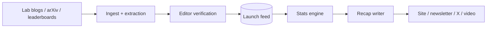

# Architecture — modelarena

## 1. Scope
Sports-style coverage of model launches: box scores, records, standings, title reigns, recaps.
**MVP:** launch feed (JSON) → box score vs. prior best, standings with days-at-#1, template recap generator.
**Product:** live ingestion pipeline, verified results, a media surface (site, newsletter, video, push alerts), fantasy league.

## 2. System context

## 3. Components
| Module | Responsibility | Status |
|---|---|---|
| `load_feed` | Parse and sort launches by date | MVP |
| `box_score` | Per benchmark: score, previous best and holder, delta, record flag; first-ever marks | MVP |
| `standings` | Title holder per benchmark and reign history → days at #1 per lab up to `as_of` | MVP |
| `recap` | Deterministic headline + play-by-play from the box score | MVP |
| Extraction | LLM-assisted table extraction from launch posts, with human verification | Roadmap |

## 4. Design decisions
- **The stats engine is pure and deterministic.** The same feed always gives the same standings, so
  coverage is auditable and corrections are a re-run.
- **A record is strictly greater than the prior best.** Ties don't steal titles.
- **Template recaps first.** An LLM rewrite layer can add voice later, but numbers always come
  from the engine (no hallucinated scores).
- **Self-reported vs. independently verified scores** become a schema field (`source`), and
  standings can filter on it.

## 5. Production architecture
Postgres (launches, scores with source and provenance URL), a nightly standings materialisation,
and a static site generator + email (Resend) + social posting workers. Push alerts on "record broken" events.

## 6. Risks
Benchmark contamination and self-reporting. Mitigate by showing provenance badges and running
independent eval partners. Brand and trademark: the name and visuals must not imply ESPN affiliation.
